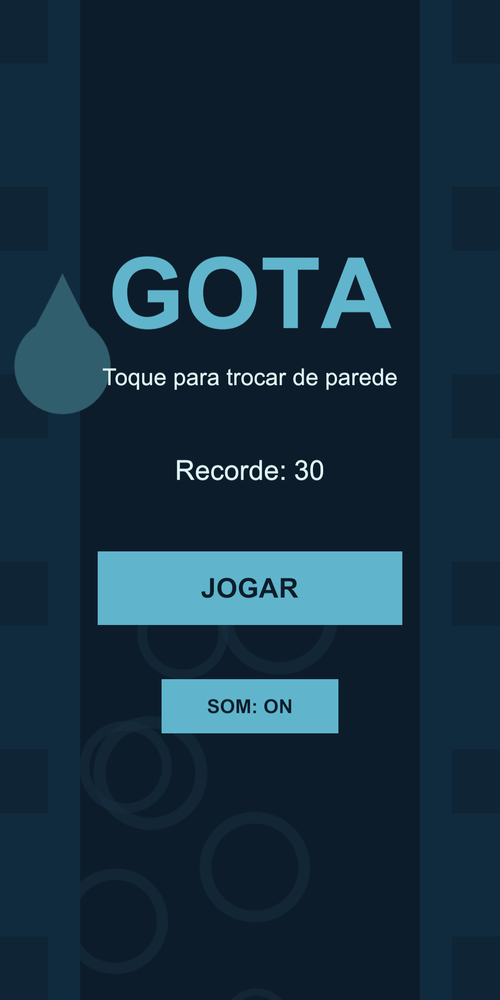
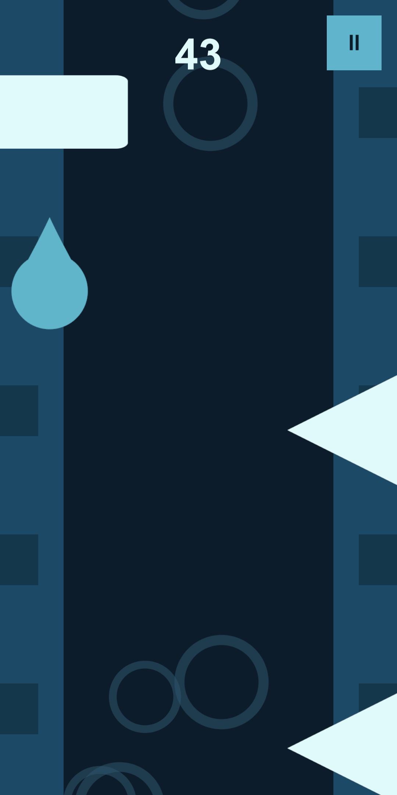

# Gota

Jogo 2D vertical de um toque para Android e navegador. Você guia uma gota d'água que cai por um cano: **toque na tela para pular para a parede oposta** e sobreviva o máximo possível enquanto a queda acelera.

<p align="center">
  
  &nbsp;&nbsp;
  
</p>

> GIF de gameplay: em breve. Para gerar: em Play Mode, menu **Gota > Gravar quadros de gameplay** (12 s com piloto automático), depois `python docs/tools/make_gif.py Temp/gif docs/gota.gif 12`.

**Jogar:** link do itch.io em breve · **Android:** teste fechado no Google Play em breve

## Como jogar

- Um toque em qualquer ponto da tela troca a gota de parede.
- Desvie dos blocos, espinhos e dos blocos que se movem.
- Pegue as gotinhas: cada uma vale +10 pontos.
- 1 ponto por metro descido. A velocidade sobe a cada 100 metros.

## Feito com

- Unity 6 (6000.6.4f1), Universal Render Pipeline 2D
- Input System (um código para mouse no editor e toque no celular)
- C# puro, sem pacotes de terceiros
- Arte e sons gerados por código (nenhum asset externo)

## Decisões técnicas

O projeto foi planejado para exercitar quatro padrões comuns em código Unity profissional. Cada um está isolado em um lugar só.

### 1. State machine — `Assets/Scripts/Core/GameStateMachine.cs`

A partida tem quatro estados: `Menu`, `Playing`, `Paused` e `GameOver`. Cada um é uma classe (`MenuState`, `PlayingState`, ...) com `Enter()` e `Exit()`. A máquina guarda o estado atual, troca sob demanda e anuncia a troca por evento.

**Por quê:** sem isso, regras como "pausar zera o `timeScale`", "voltar ao menu limpa os obstáculos" e "game over salva o recorde" ficariam espalhadas em `if`s pelo projeto. Com estados, cada regra mora no `Enter`/`Exit` do estado dono dela. Adicionar um estado novo (por exemplo, "Continuar com anúncio") é criar uma classe, não editar dez.

### 2. Object pooling — `Assets/Scripts/Core/ObjectPool.cs` e `Obstacles/ObstacleSpawner.cs`

`ObjectPool<T>` é uma classe genérica que instancia todos os objetos no início (`prewarm`) e depois só ativa e desativa. O spawner mantém um pool por prefab (bloco, espinho, móvel, coletável). Quando um obstáculo sai pelo topo da tela, o componente `Scrollable` avisa e ele volta ao pool.

**Por quê:** `Instantiate` e `Destroy` geram lixo para o garbage collector, e no celular isso vira travadinhas justamente quando a tela está cheia. Com pool, a quantidade de objetos é constante durante a partida inteira. Dá para conferir no Profiler: zero alocações por spawn.

### 3. ScriptableObjects — `Assets/Scripts/Data/DifficultyConfig.cs` e `GamePalette.cs`

`DifficultyConfig` guarda a curva de dificuldade (velocidade inicial, incremento a cada 100 m, limite, intervalo entre obstáculos, chance de coletável). `GamePalette` guarda as 4 cores do jogo; o componente `PaletteColor` pinta qualquer `SpriteRenderer`, `Image`, `Text`, `Camera` ou `ParticleSystem` a partir dela.

**Por quê:** balanceamento e identidade visual são decisões de design, não de código. Com SOs, dá para ajustar tudo no Inspector, criar variantes ("fácil", "difícil", "modo daltônico") e testar sem recompilar. E a paleta garante que nenhuma cor fora das 4 entre na cena por acidente.

### 4. C# events — `Assets/Scripts/Core/GameEvents.cs`

Uma classe estática com eventos: `OnWallSwitched`, `OnPlayerDied`, `OnCollected`, `OnScoreChanged`, `OnHighScoreChanged`, `OnStateChanged`. O gameplay dispara; UI, áudio e efeitos escutam.

**Por quê:** o `PlayerController` não referencia `AudioSource`, `ParticleSystem` nem nenhum elemento de UI. Ele só sabe trocar de parede e detectar colisão. Trocar o som do toque, adicionar vibração ou um contador de estatísticas é criar um ouvinte novo, sem tocar no controle do jogador. Isso também deixa cada parte testável sozinha.

### Outras escolhas

- **A gota não cai; o mundo sobe.** A gota fica parada no eixo Y e `WorldScroller` define uma velocidade única que paredes, fundo, obstáculos e coletáveis seguem. Isso simplifica a câmera (fixa) e o pooling (posições previsíveis).
- **Rigidbody2D cinemático com `useFullKinematicContacts`.** Sem essa flag, corpos cinemáticos não geram triggers com colliders estáticos.
- **Sprites e sons por código.** Formas desenhadas com funções de distância (SDF) e WAVs sintetizados em C#. Zero dependência de arte externa, e tudo versionado como texto gerador.

## Estrutura

```
Assets/
  Scripts/
    Core/       GameEvents, GameStateMachine, ObjectPool, ScoreManager, HighScoreService
    Player/     PlayerController
    World/      WorldScroller, ScrollingSegment
    Obstacles/  Obstacle, MovingObstacle, Collectible, Scrollable, ObstacleSpawner
    Data/       DifficultyConfig, GamePalette, PaletteColor
    Effects/    EffectsManager, CameraShake
    Audio/      AudioManager
    UI/         UIManager, MuteButton, FirstPlayHint
  Prefabs/      Obstacle_Block, Obstacle_Spike, Obstacle_Mover, Collectible_Drop
  Data/         DifficultyConfig.asset, GamePalette.asset
  Art/          sprites e ícone (PNG)
  Audio/        sons e música (WAV)
docs/
  devlog/       um post por marco
  screenshots/
```

## Rodar o projeto

1. Instale o Unity Hub e o Unity **6000.6.4f1** com WebGL e Android Build Support.
2. Clone este repositório e abra a pasta no Unity Hub.
3. Abra `Assets/Scenes/SampleScene.unity` e aperte Play. No editor, o clique do mouse faz o papel do toque.

Builds: `File > Build Profiles`, escolha Android ou Web.

## Devlog

- [Marco 0 — Ambiente](docs/devlog/01-marco-0-ambiente.md)
- [Marco 1 — Mecânica principal](docs/devlog/02-marco-1-mecanica.md)
- [Marco 2 — Jogo completo](docs/devlog/03-marco-2-jogo-completo.md)
- [Marco 3 — Arte, som e sensação](docs/devlog/04-marco-3-arte-e-som.md)

## Depois da 1.0

- Anúncios recompensados para continuar a partida
- Skins de gota
- Ranking online

## Licença

Código sob licença MIT. Arte e sons são gerados por código e seguem a mesma licença.
