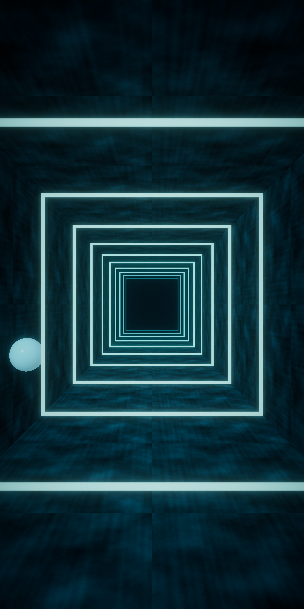
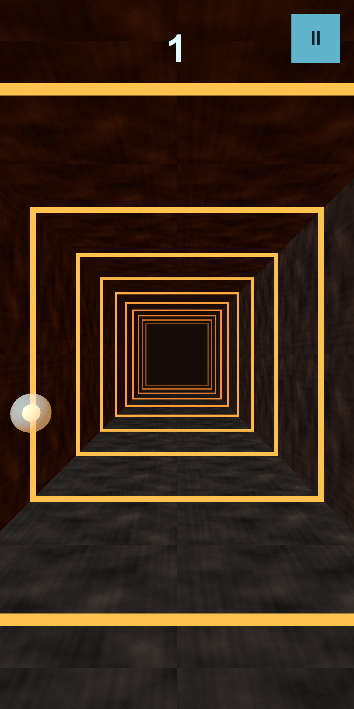
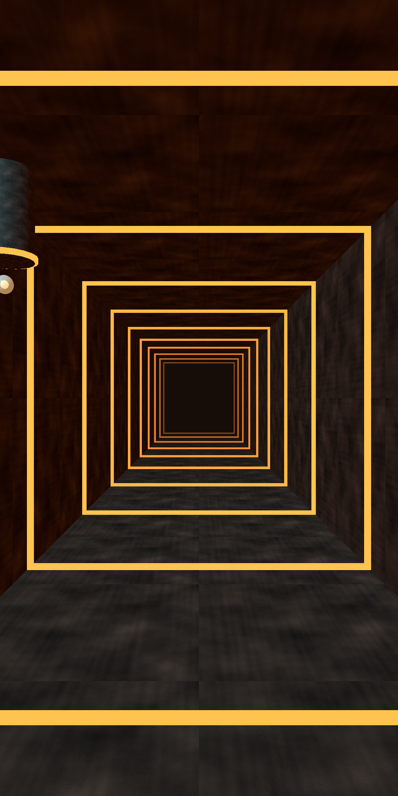

# Devlog 5 — Marco 5: Direção de arte 2.5D

**Data:** 15/11/2026

Meta do marco: o jogo passa a parecer o vídeo-conceito (túnel escuro de concreto com aros de neon), sem reescrever a lógica de jogo.

  
  &nbsp;
  
  &nbsp;
  

## O que ficou pronto

- **Cena `Tunnel` em 3D** com câmera em perspectiva. A cena 2D (`SampleScene`) continua no projeto, desligada na build, como válvula de escape.
- **Túnel infinito**: 6 segmentos de 10 m (4 placas de concreto + 2 aros de neon cada) reciclados pelo mesmo `ScrollingSegment` de antes, agora com `loopLength`.
- **Materiais gerados por código**: textura de concreto por ruído fractal, neon HDR sem luz (o bloom faz o brilho), vidro transparente para a gota com um núcleo de luz dentro, branco frio para obstáculos. Bloom com 4 passes e meia resolução.
- **Prefabs 3D** dos obstáculos e da gotinha, copiados dos prefabs 2D: mesmos colisores 2D, mesmos scripts, só o visual mudou (cubo, pirâmide, esfera).
- **Biomas**: Ferrugem (0–300 m) e Neon (300 m+), cada um uma `GamePalette`. `TunnelMaterials.Apply` interpola as quatro cores para materiais, névoa, luz ambiente e fundo.
- **Portal** entre biomas: 1,5 s invulnerável, velocidade x2, sem obstáculos novos, um aro grosso atravessa a tela e o nome do bioma aparece.
- **Abertura**: na primeira vez que o app abre, a gota nasce na boca de um cano, cai e assenta na parede. Um toque pula. Depois o cano fica como cenário do menu, o túnel desliza devagar e a gota "respira".
- **Ferramenta `Gota > Túnel`**: seis passos de editor que montam tudo do zero (renderer, materiais, prefabs, cena, biomas, abertura). Rodar "Tudo" reconstrói a cena em segundos; nada foi feito à mão no Inspector.

## Decisão técnica: o mundo continua 2D

A câmera fica em Y positivo olhando para −Y, com o teto do túnel em +Z. Assim:

- **X** continua sendo esquerda/direita (gameplay);
- **Y** virou profundidade: o cenário continua subindo em +Y, exatamente como antes;
- **Z** é chão/teto, só visual.

`WorldScroller`, `ObstacleSpawner`, `PlayerController` (física 2D no plano XY) e a máquina de estados não mudaram uma linha de lógica. A física 2D ignora Z, então os colisores antigos funcionam dentro de uma cena 3D. A migração custou um dia, não duas semanas.

## Decisão técnica: um material por papel

Em vez de pintar cada `MeshRenderer` (como o `PaletteColor` faz com sprites), `TunnelMaterials` cria **uma cópia de execução por papel visual** (concreto, neon, perigo, gotinha, vidro) e `MaterialSlotRenderer` entrega a mesma cópia a todos os objetos daquele papel. O SRP Batcher agrupa tudo e trocar de bioma é mudar cinco cores em cinco materiais.

## Medições (editor, placa de vídeo de desktop)

| | GPU por quadro |
|---|---|
| Sem bloom | ~1,1 ms |
| Com bloom (4 passes, meia resolução) | ~5 ms |

A meta do GDD (≤ 2 ms) é para o celular e ainda não foi medida lá. Se estourar, o primeiro corte é `Render Scale` 0,8 no pipeline.

## Pendente

- Medir no Redmi Note 12 (o celular não estava conectado na hora da build).
- O neon laranja do bioma Ferrugem ainda puxa um pouco para amarelo no tone mapping ACES.
- A UI (HUD, botões) continua ciano em todos os biomas.

## Próximo marco

Marco 6: evaporação (a gota encolhe e seca), laser pulsante, combo e escudo de cristal.
